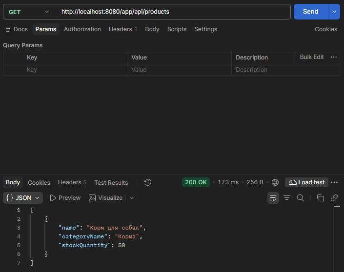

# Отчет по лабораторной работе №5. Разработка и развертывание Web-приложений

**Цель работы:** 
Разработка веб-приложения на основе Java-сервлетов и развертывание его на сервере приложений Apache Tomcat 11. Реализация взаимодействия с базой данных через Spring-контекст, создание HTML-интерфейса для управления заказами и REST-сервиса для получения данных о продуктах.

**Выполнение работы:**
1) Скачан и установлен сервер приложений Apache Tomcat 11.
2) В конфигурационный файл Tomcat (`conf/tomcat-users.xml`) добавлен пользователь с правами администратора и менеджера для доступа к панели управления.
3) Обновлен файл `build.gradle.kts`: добавлен плагин `war`, а также зависимости `jakarta.servlet-api`, `spring-web` и `jackson-databind` (для работы с JSON).
4) Создан файл `src/main/webapp/WEB-INF/web.xml` для инициализации Spring-контекста (`ContextLoaderListener`) при старте Tomcat.
5) Создан класс `DataInitializer.java` с аннотацией `@PostConstruct`. Так как при запуске на сервере метод `main` не вызывается, этот класс автоматически заполняет базу данных H2 тестовыми клиентами, категориями и продуктами при старте приложения.
6) Создан сервлет `OrderListServlet.java` (маппинг `/orders`), который формирует HTML-страницу со списком всех заказов и кнопкой перехода к форме создания.
7) Создан сервлет `CreateOrderServlet.java` (маппинг `/create-order`), который обрабатывает GET-запрос (отображение формы с выпадающим списком клиентов) и POST-запрос (создание заказа и перенаправление обратно на список).
8) Создан сервлет `ProductRestServlet.java` (маппинг `/api/products`), который с помощью библиотеки Jackson формирует JSON-ответ с информацией о названии продукта, категории и количестве на складе.
9) Проект собран с помощью команды `gradle war`. Полученный файл `app.war` скопирован в директорию `webapps` сервера Tomcat.
10) Выполнено тестирование веб-интерфейса (создание заказов через браузер) и REST-сервиса с использованием программы Postman.
11) Составлена UML-диаграмма классов с помощью Mermaid.

**Выводы:** 
В ходе выполнения лабораторной работы приложение было успешно переведено в формат веб-приложения (WAR). Освоена настройка сервера Apache Tomcat, написание Java-сервлетов для обработки HTTP-запросов (GET/POST), а также создание REST API с сериализацией данных в JSON. Настроена бесшовная интеграция веб-слоя с ранее разработанным слоем бизнес-логики на базе Spring и Hibernate.

**Результат тестирования REST API (Postman):**



**Диаграмма Mermaid:**

```mermaid
classDiagram
    direction TB

    class OrderListServlet {
        -OrderService orderService
        +doGet(req, resp)
    }

    class CreateOrderServlet {
        -OrderService orderService
        -CustomerRepository customerRepository
        +doGet(req, resp)
        +doPost(req, resp)
    }

    class ProductRestServlet {
        -ProductRepository productRepository
        +doGet(req, resp)
    }

    class DataInitializer {
        +initData()
    }

    class OrderService {
        +createOrder(Order order) Order
        +getAllOrders() List~Order~
    }

    class CustomerRepository {
        <<Interface>>
    }

    class ProductRepository {
        <<Interface>>
    }

    class OrderRepository {
        <<Interface>>
    }

    class Order {
        -Long id
        -Customer customer
        -BigDecimal totalPrice
    }

    class Customer {
        -Long id
        -String name
    }

    class Product {
        -Long id
        -String name
        -Category category
        -Integer stockQuantity
    }

    class Category {
        -Long id
        -String name
    }

    %% Связи между слоями и классами
    OrderListServlet --> OrderService : uses
    CreateOrderServlet --> OrderService : uses
    CreateOrderServlet --> CustomerRepository : uses
    ProductRestServlet --> ProductRepository : uses

    DataInitializer ..> CustomerRepository : fills data
    DataInitializer ..> ProductRepository : fills data

    OrderService --> OrderRepository : uses
    Order --> Customer : belongs to
    Product --> Category : belongs to
    ```