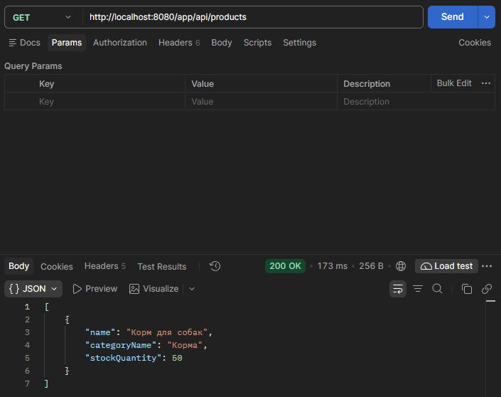

# Отчет по лабораторной работе №12. Spring MVC и Thymeleaf

**Цель работы:** 
Перевод веб-приложения на архитектуру Spring MVC. Реализация полноценного REST API для работы с заказами (CRUD) и создание веб-интерфейса с использованием шаблонизатора Thymeleaf. Развертывание приложения на сервере Apache Tomcat 11.

**Выполнение работы:**
1) Удалены старые сервлеты (`OrderListServlet`, `CreateOrderServlet`, `ProductRestServlet`), так как Spring MVC полностью берет на себя маршрутизацию запросов.
2) Обновлен файл `build.gradle.kts`: добавлены зависимости `spring-webmvc`, `thymeleaf-spring6` и модуль `jackson-datatype-jsr310` для корректной работы с датами в JSON.
3) Обновлен файл `web.xml`: вместо отдельных сервлетов настроен главный `DispatcherServlet`, который передает запросы соответствующим контроллерам.
4) Создан класс `WebConfig.java` с аннотацией `@EnableWebMvc`. В нем настроены `SpringResourceTemplateResolver` и `ThymeleafViewResolver` для работы с HTML-шаблонами, а также добавлен `MappingJackson2HttpMessageConverter` для сериализации дат (`LocalDateTime`).
5) В сущности `Order` и `Category` добавлена аннотация `@JsonIgnore` над связанными коллекциями. Это решило проблему ошибки 500 (Lazy Loading), которая возникала при попытке превратить объекты Hibernate в JSON.
6) В класс `OrderService` добавлены методы `getOrderById` и `deleteOrder` для обеспечения полного CRUD-цикла.
7) Создан класс `OrderRestController.java` (аннотация `@RestController`). В нем реализованы 5 эндпоинтов для работы с заказами через REST API (GET, GET by ID, POST, PUT, DELETE).
8) Создан класс `OrderViewController.java` (аннотация `@Controller`), который обрабатывает запросы от браузера и возвращает имена HTML-шаблонов.
9) В папке `src/main/webapp/WEB-INF/templates/` созданы два Thymeleaf-шаблона: `orders.html` (таблица со списком заказов) и `order-form.html` (форма для создания и редактирования). 
10) Проект собран командой `gradle war` и успешно развернут на Apache Tomcat 11.
11) Выполнено тестирование веб-интерфейса (создание, редактирование и удаление заказов через браузер).
12) Выполнено тестирование REST API с использованием программы Postman (создана коллекция запросов).
13) Составлена UML-диаграмма классов с помощью Mermaid.

**Выводы:** 
В ходе выполнения лабораторной работы приложение было успешно переведено на паттерн MVC. Освоено использование Spring MVC для создания как классических веб-интерфейсов (с помощью Thymeleaf), так и REST API. Изучены особенности сериализации данных Hibernate в JSON и способы решения проблем с ленивой загрузкой (Lazy Loading) и типами данных дат (LocalDateTime).

**Результат тестирования REST API (Postman):**



**Диаграмма Mermaid:**

```mermaid
classDiagram
    direction TB

    class OrderRestController {
        <<RestController>>
        -OrderService orderService
        +getAllOrders() List~Order~
        +getOrderById(Long) ResponseEntity
        +createOrder(Order) Order
        +updateOrder(Long, Order) ResponseEntity
        +deleteOrder(Long) ResponseEntity
    }

    class OrderViewController {
        <<Controller>>
        -OrderService orderService
        -CustomerRepository customerRepository
        +listOrders(Model) String
        +showCreateForm(Model) String
        +showEditForm(Long, Model) String
        +saveOrder(Long, BigDecimal, Long) String
        +deleteOrder(Long) String
    }

    class WebConfig {
        <<Configuration>>
        <<EnableWebMvc>>
        +templateResolver() SpringResourceTemplateResolver
        +templateEngine() SpringTemplateEngine
        +viewResolver() ThymeleafViewResolver
        +configureMessageConverters(List) void
    }

    class OrderService {
        +createOrder(Order) Order
        +getAllOrders() List~Order~
        +getOrderById(Long) Order
        +deleteOrder(Long) void
    }

    class OrderRepository {
        <<Interface>>
    }

    class CustomerRepository {
        <<Interface>>
    }

    class Order {
        -Long id
        -Customer customer
        -BigDecimal totalPrice
        -String status
    }

    class Customer {
        -Long id
        -String name
    }

    class Category {
        -Long id
        -String name
    }

    %% Связи
    OrderRestController --> OrderService : uses
    OrderViewController --> OrderService : uses
    OrderViewController --> CustomerRepository : uses
    WebConfig ..> OrderViewController : configures
    
    OrderService --> OrderRepository : uses
    Order --> Customer : belongs to
    Order --> Category : (via details)
    ```